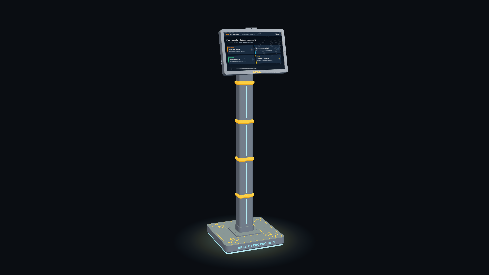

# Умный Киоск — Интеллектуальный кампусный терминал APEC

Интеллектуальный аппаратно-программный терминал для кампуса **Высшего колледжа APEC PetroTechnic** (Атырау, Казахстан).

## 📌 О проекте
«Умный Киоск» — это физический AI-шлюз и точка притяжения кампуса, объединяющая академические сервисы, голосовой интеллект, умную навигацию и индустриальную айдентику в одном устройстве.

### Ключевые возможности:
1. **01 / Академический профиль студента:** Мгновенный доступ к личной успеваемости, текущему GPA, посещаемости и статусу допусков к экзаменам в один клик по ID-карте без визита в учебную часть.
2. **02 / Умное расписание онлайн:** Интерактивная сетка занятий с мгновенным поиском по группам, аудиториям и преподавателям с учетом замен.
3. **03 / 3D-навигатор кампуса:** Пошаговая поэтажная навигация по мастерским, лабораториям и полигонам APEC с переносом маршрута в смартфон по QR-коду.
4. **04 / Карьерный лифт:** Витрина стажировок и программ практики от индустриальных гигантов (ТШО, NCOC, КазМунайГаз).

---

## ⚙️ Инженерная ДНК и дизайн
* **Колонна-трубопровод:** 5 модульных секций со стилизованными оранжевыми фланцами — отражение нефтегазовой школы APEC PetroTechnic.
* **Национальный код:** Рельефный традиционный казахский орнамент «қошқар мүйіз» на крышках основания.
* **Световой язык (WS2812B):** Адресная подсветка статусов (*Ожидание → Распознавание карты → Голосовой AI: Слушает и Думает*) и круговой свет underglow в пол.
* **Эргономика:** Сенсорный экран с наклоном 15° и высотой центра 140 см (антибликовый комфортный обзор).

---

## 📊 Результаты внедрения
* **–20%** рутинной нагрузки заведующих отделениями.
* **3 ч ➔ 24/7** доступность оперативной поддержки студентов.
* **10 сек** на проверку успеваемости, GPA и допусков по ID-карте.
* **5 сек** на поиск любой аудитории или полигона по 3D-карте.

---

## 📬 Контакты
По вопросам пилотного внедрения и сотрудничества:  
Официальная почта колледжа: **info@apec.edu.kz**
